<!-- Generated from the original r-project.ro live page. Newest first.
     To add photos: drop them into photos/dayN/ and copy a block below. -->

::: {.panel-tabset}

### Day 3 · 2nd day of the Conference

[C6 - Data Integration, Survey Processes and Quality]{.photo-caption}

::: {.photo-grid}

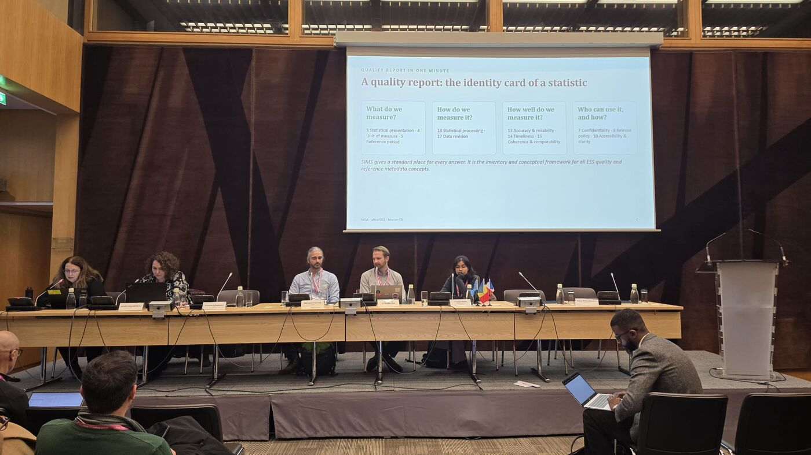{.lightbox group="day-3-2nd-day-of-the-conference-0" description="C6 - Data Integration, Survey Processes and Quality" fig-alt="Photo 1 of 8 from uRos2026, Day 3 · 2nd day of the Conference: C6 - Data Integration, Survey Processes and Quality" loading="lazy"}

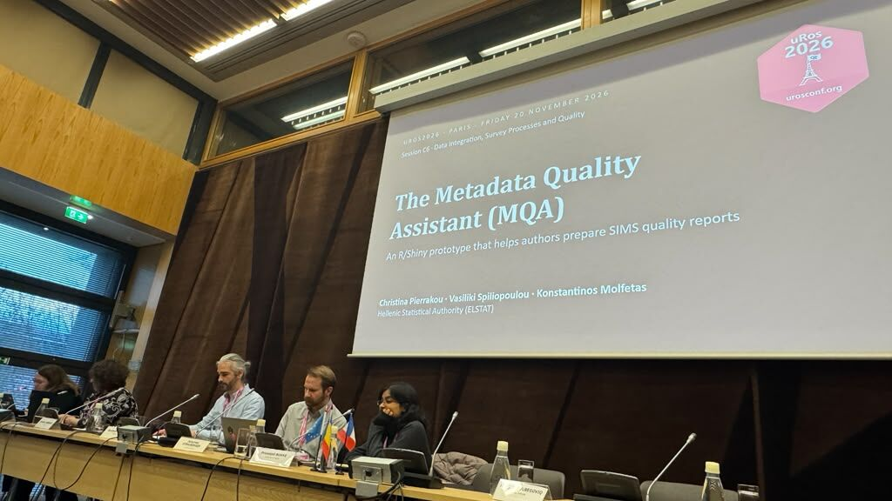{.lightbox group="day-3-2nd-day-of-the-conference-0" description="C6 - Data Integration, Survey Processes and Quality" fig-alt="Photo 2 of 8 from uRos2026, Day 3 · 2nd day of the Conference: C6 - Data Integration, Survey Processes and Quality" loading="lazy"}

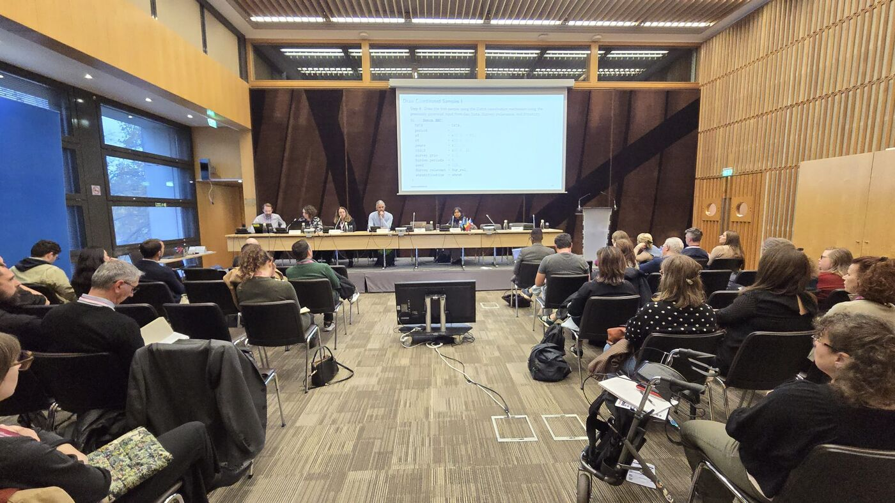{.lightbox group="day-3-2nd-day-of-the-conference-0" description="C6 - Data Integration, Survey Processes and Quality" fig-alt="Photo 3 of 8 from uRos2026, Day 3 · 2nd day of the Conference: C6 - Data Integration, Survey Processes and Quality" loading="lazy"}

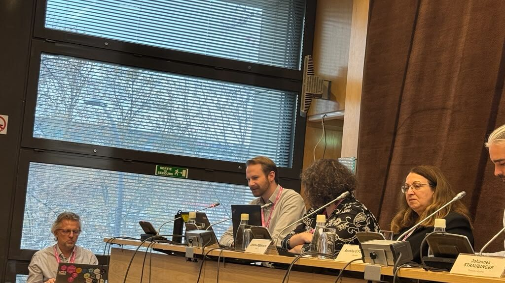{.lightbox group="day-3-2nd-day-of-the-conference-0" description="C6 - Data Integration, Survey Processes and Quality" fig-alt="Photo 4 of 8 from uRos2026, Day 3 · 2nd day of the Conference: C6 - Data Integration, Survey Processes and Quality" loading="lazy"}

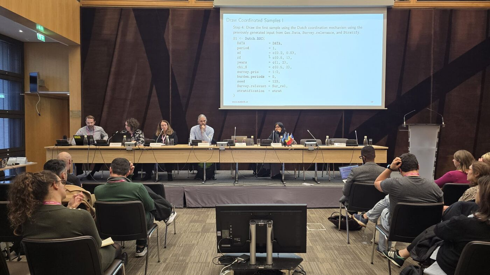{.lightbox group="day-3-2nd-day-of-the-conference-0" description="C6 - Data Integration, Survey Processes and Quality" fig-alt="Photo 5 of 8 from uRos2026, Day 3 · 2nd day of the Conference: C6 - Data Integration, Survey Processes and Quality" loading="lazy"}

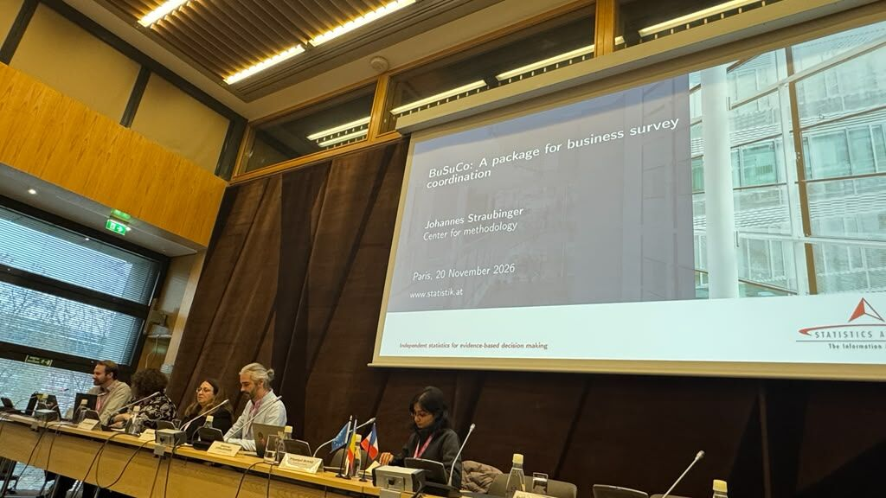{.lightbox group="day-3-2nd-day-of-the-conference-0" description="C6 - Data Integration, Survey Processes and Quality" fig-alt="Photo 6 of 8 from uRos2026, Day 3 · 2nd day of the Conference: C6 - Data Integration, Survey Processes and Quality" loading="lazy"}

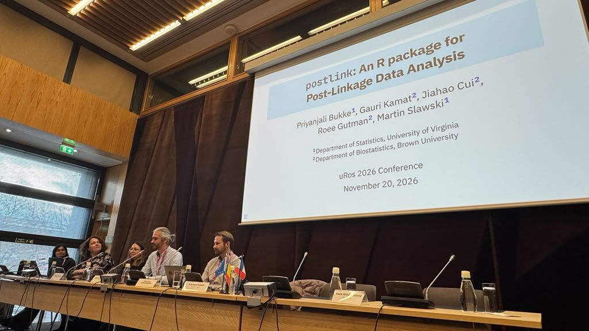{.lightbox group="day-3-2nd-day-of-the-conference-0" description="C6 - Data Integration, Survey Processes and Quality" fig-alt="Photo 7 of 8 from uRos2026, Day 3 · 2nd day of the Conference: C6 - Data Integration, Survey Processes and Quality" loading="lazy"}

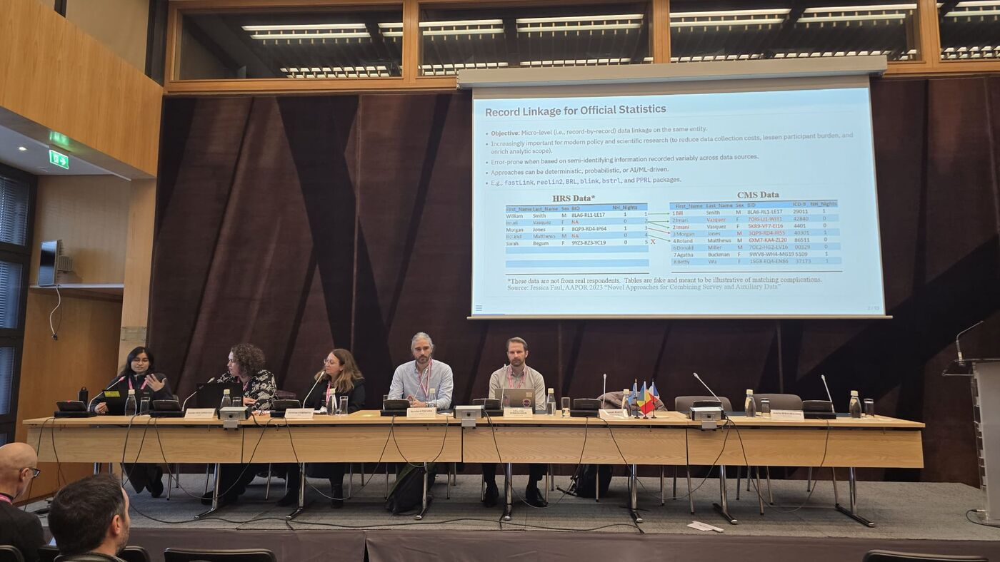{.lightbox group="day-3-2nd-day-of-the-conference-0" description="C6 - Data Integration, Survey Processes and Quality" fig-alt="Photo 8 of 8 from uRos2026, Day 3 · 2nd day of the Conference: C6 - Data Integration, Survey Processes and Quality" loading="lazy"}

:::

[A6 - Nowcasting and Time-Series Methods]{.photo-caption}

::: {.photo-grid}

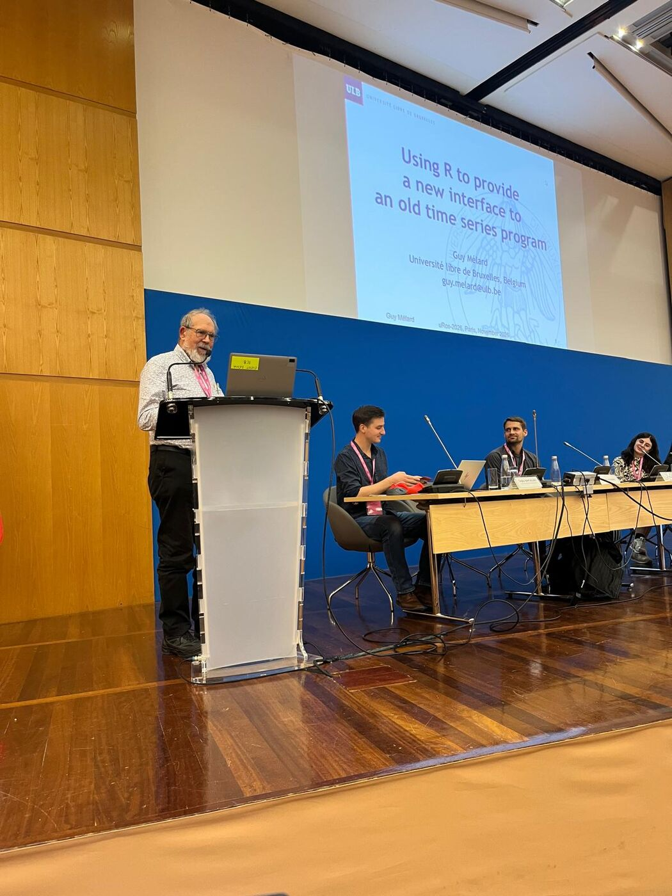{.lightbox group="day-3-2nd-day-of-the-conference-1" description="A6 - Nowcasting and Time-Series Methods" fig-alt="Photo 1 of 3 from uRos2026, Day 3 · 2nd day of the Conference: A6 - Nowcasting and Time-Series Methods" loading="lazy"}

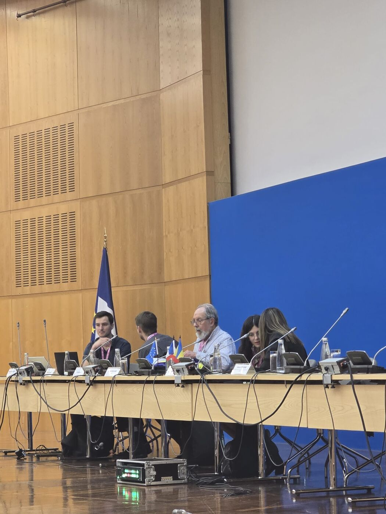{.lightbox group="day-3-2nd-day-of-the-conference-1" description="A6 - Nowcasting and Time-Series Methods" fig-alt="Photo 2 of 3 from uRos2026, Day 3 · 2nd day of the Conference: A6 - Nowcasting and Time-Series Methods" loading="lazy"}

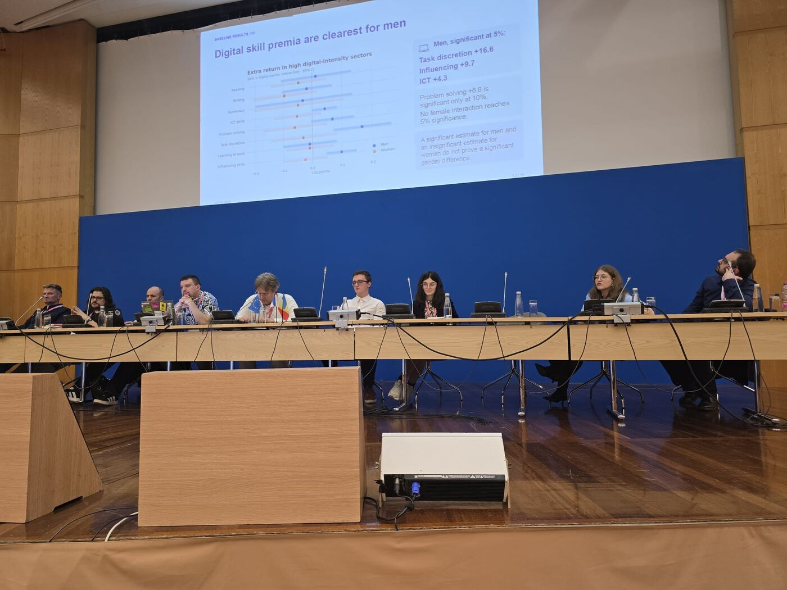{.lightbox group="day-3-2nd-day-of-the-conference-1" description="A6 - Nowcasting and Time-Series Methods" fig-alt="Photo 3 of 3 from uRos2026, Day 3 · 2nd day of the Conference: A6 - Nowcasting and Time-Series Methods" loading="lazy"}

:::

[C5 - Imputation and Advanced Statistical Methods]{.photo-caption}

::: {.photo-grid}

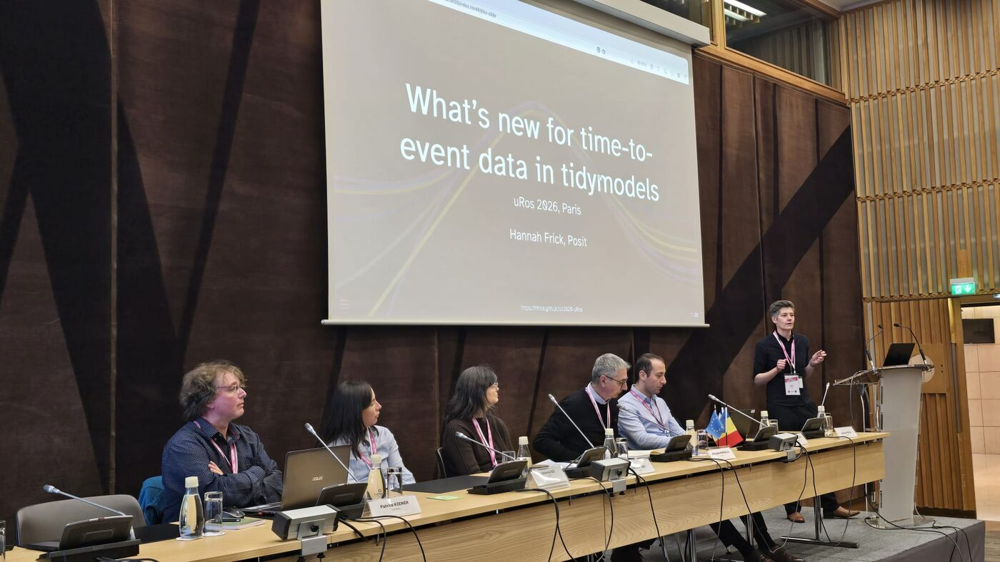{.lightbox group="day-3-2nd-day-of-the-conference-2" description="C5 - Imputation and Advanced Statistical Methods" fig-alt="Photo 1 of 6 from uRos2026, Day 3 · 2nd day of the Conference: C5 - Imputation and Advanced Statistical Methods" loading="lazy"}

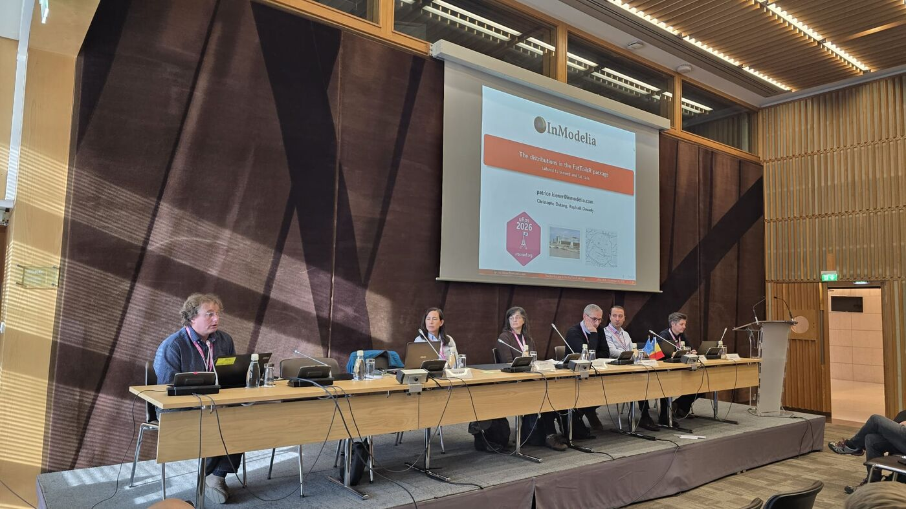{.lightbox group="day-3-2nd-day-of-the-conference-2" description="C5 - Imputation and Advanced Statistical Methods" fig-alt="Photo 2 of 6 from uRos2026, Day 3 · 2nd day of the Conference: C5 - Imputation and Advanced Statistical Methods" loading="lazy"}

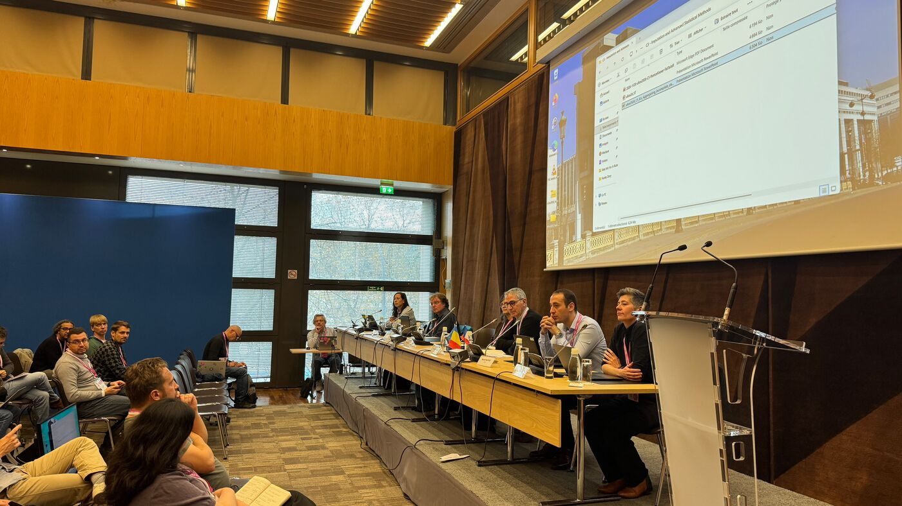{.lightbox group="day-3-2nd-day-of-the-conference-2" description="C5 - Imputation and Advanced Statistical Methods" fig-alt="Photo 3 of 6 from uRos2026, Day 3 · 2nd day of the Conference: C5 - Imputation and Advanced Statistical Methods" loading="lazy"}

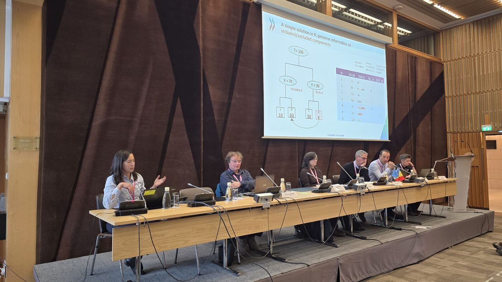{.lightbox group="day-3-2nd-day-of-the-conference-2" description="C5 - Imputation and Advanced Statistical Methods" fig-alt="Photo 4 of 6 from uRos2026, Day 3 · 2nd day of the Conference: C5 - Imputation and Advanced Statistical Methods" loading="lazy"}

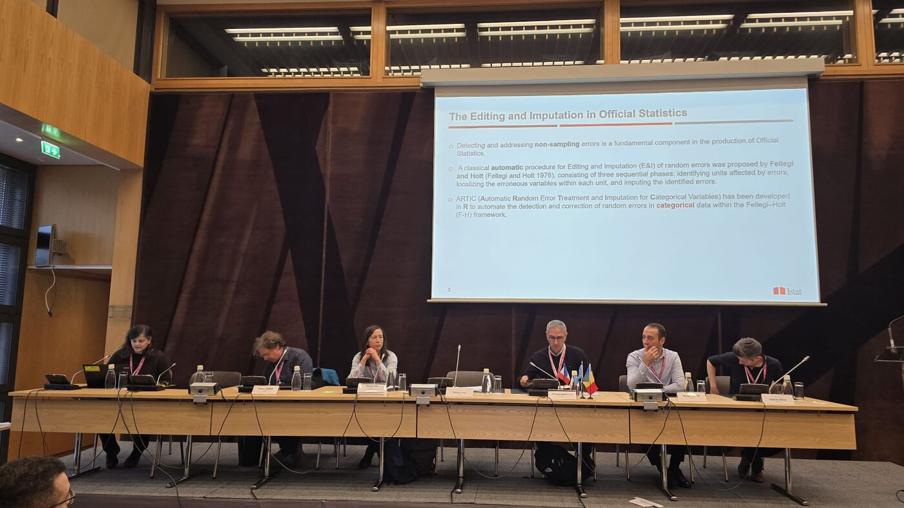{.lightbox group="day-3-2nd-day-of-the-conference-2" description="C5 - Imputation and Advanced Statistical Methods" fig-alt="Photo 5 of 6 from uRos2026, Day 3 · 2nd day of the Conference: C5 - Imputation and Advanced Statistical Methods" loading="lazy"}

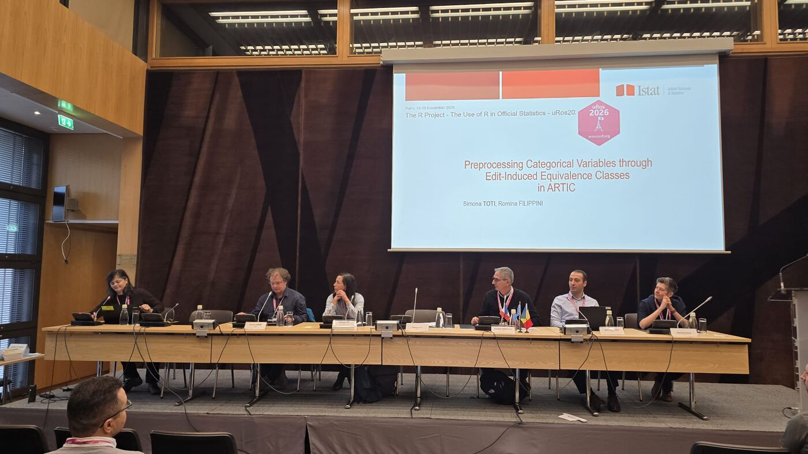{.lightbox group="day-3-2nd-day-of-the-conference-2" description="C5 - Imputation and Advanced Statistical Methods" fig-alt="Photo 6 of 6 from uRos2026, Day 3 · 2nd day of the Conference: C5 - Imputation and Advanced Statistical Methods" loading="lazy"}

:::

[B5 - Spatial and Small Area Analysis]{.photo-caption}

::: {.photo-grid}

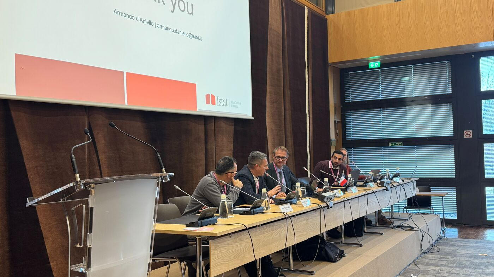{.lightbox group="day-3-2nd-day-of-the-conference-3" description="B5 - Spatial and Small Area Analysis" fig-alt="Photo 1 of 1 from uRos2026, Day 3 · 2nd day of the Conference: B5 - Spatial and Small Area Analysis" loading="lazy"}

:::

[A5 - Lightning Talks II: R Tools, Visualisation and Applications]{.photo-caption}

::: {.photo-grid}

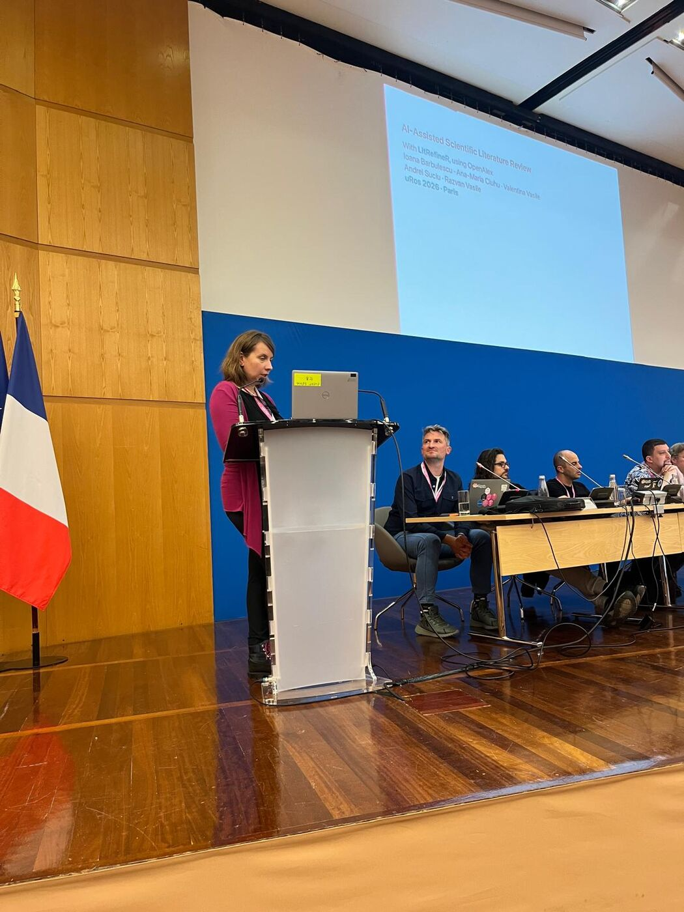{.lightbox group="day-3-2nd-day-of-the-conference-4" description="A5 - Lightning Talks II: R Tools, Visualisation and Applications" fig-alt="Photo 1 of 11 from uRos2026, Day 3 · 2nd day of the Conference: A5 - Lightning Talks II: R Tools, Visualisation and Applications" loading="lazy"}

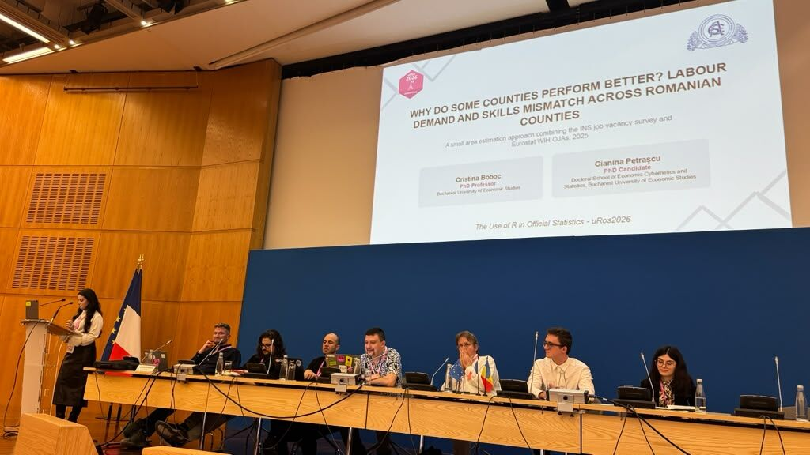{.lightbox group="day-3-2nd-day-of-the-conference-4" description="A5 - Lightning Talks II: R Tools, Visualisation and Applications" fig-alt="Photo 2 of 11 from uRos2026, Day 3 · 2nd day of the Conference: A5 - Lightning Talks II: R Tools, Visualisation and Applications" loading="lazy"}

{.lightbox group="day-3-2nd-day-of-the-conference-4" description="A5 - Lightning Talks II: R Tools, Visualisation and Applications" fig-alt="Photo 3 of 11 from uRos2026, Day 3 · 2nd day of the Conference: A5 - Lightning Talks II: R Tools, Visualisation and Applications" loading="lazy"}

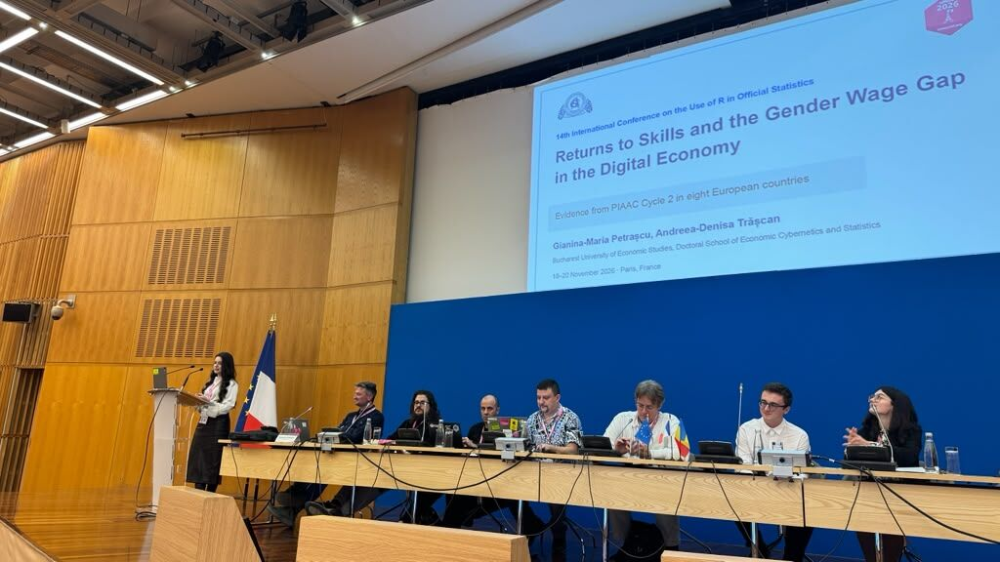{.lightbox group="day-3-2nd-day-of-the-conference-4" description="A5 - Lightning Talks II: R Tools, Visualisation and Applications" fig-alt="Photo 4 of 11 from uRos2026, Day 3 · 2nd day of the Conference: A5 - Lightning Talks II: R Tools, Visualisation and Applications" loading="lazy"}

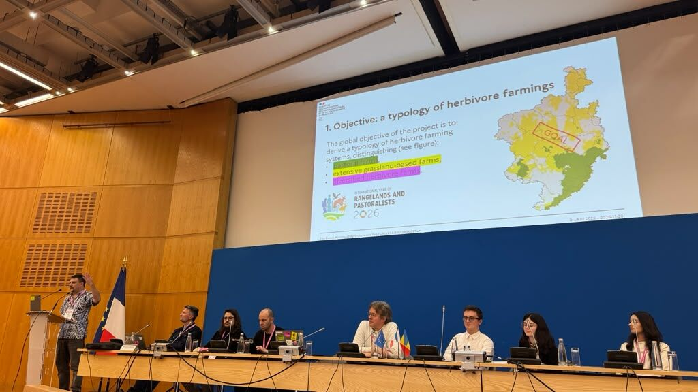{.lightbox group="day-3-2nd-day-of-the-conference-4" description="A5 - Lightning Talks II: R Tools, Visualisation and Applications" fig-alt="Photo 5 of 11 from uRos2026, Day 3 · 2nd day of the Conference: A5 - Lightning Talks II: R Tools, Visualisation and Applications" loading="lazy"}

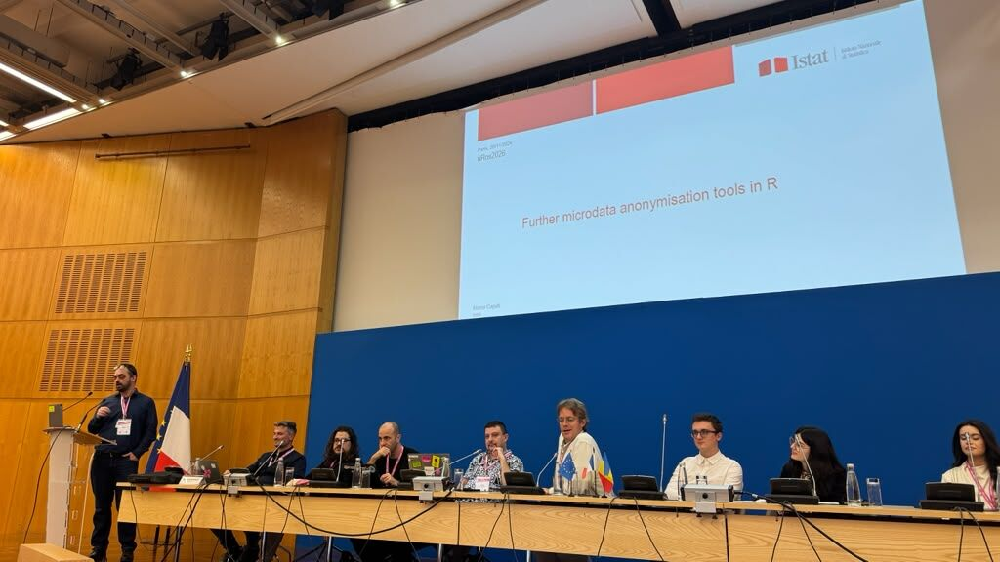{.lightbox group="day-3-2nd-day-of-the-conference-4" description="A5 - Lightning Talks II: R Tools, Visualisation and Applications" fig-alt="Photo 6 of 11 from uRos2026, Day 3 · 2nd day of the Conference: A5 - Lightning Talks II: R Tools, Visualisation and Applications" loading="lazy"}

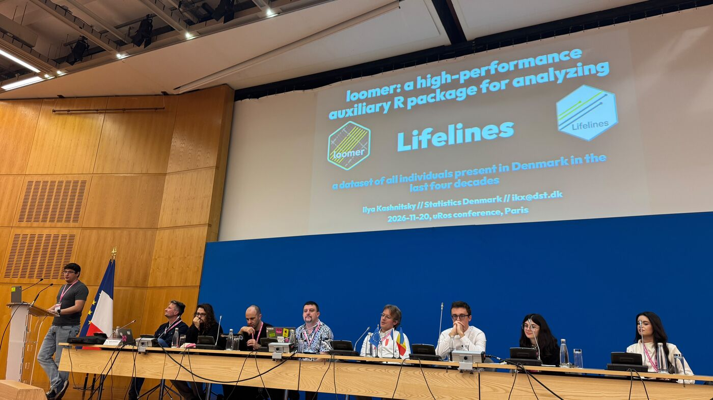{.lightbox group="day-3-2nd-day-of-the-conference-4" description="A5 - Lightning Talks II: R Tools, Visualisation and Applications" fig-alt="Photo 7 of 11 from uRos2026, Day 3 · 2nd day of the Conference: A5 - Lightning Talks II: R Tools, Visualisation and Applications" loading="lazy"}

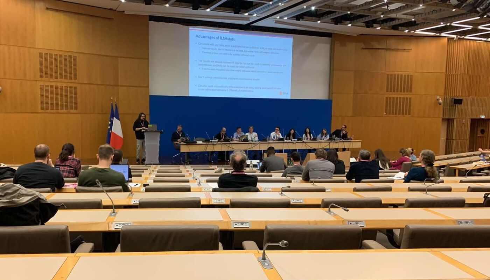{.lightbox group="day-3-2nd-day-of-the-conference-4" description="A5 - Lightning Talks II: R Tools, Visualisation and Applications" fig-alt="Photo 8 of 11 from uRos2026, Day 3 · 2nd day of the Conference: A5 - Lightning Talks II: R Tools, Visualisation and Applications" loading="lazy"}

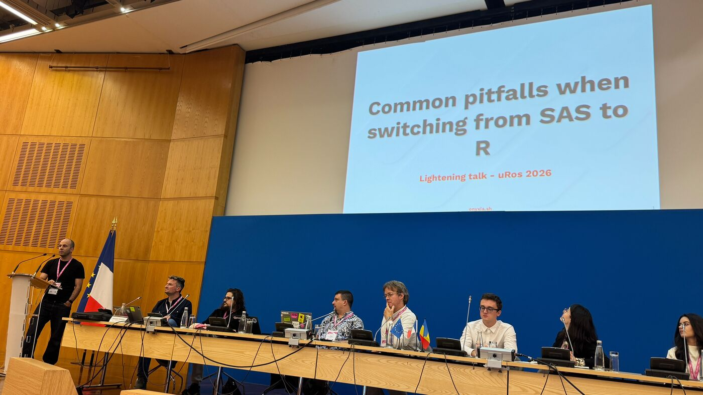{.lightbox group="day-3-2nd-day-of-the-conference-4" description="A5 - Lightning Talks II: R Tools, Visualisation and Applications" fig-alt="Photo 9 of 11 from uRos2026, Day 3 · 2nd day of the Conference: A5 - Lightning Talks II: R Tools, Visualisation and Applications" loading="lazy"}

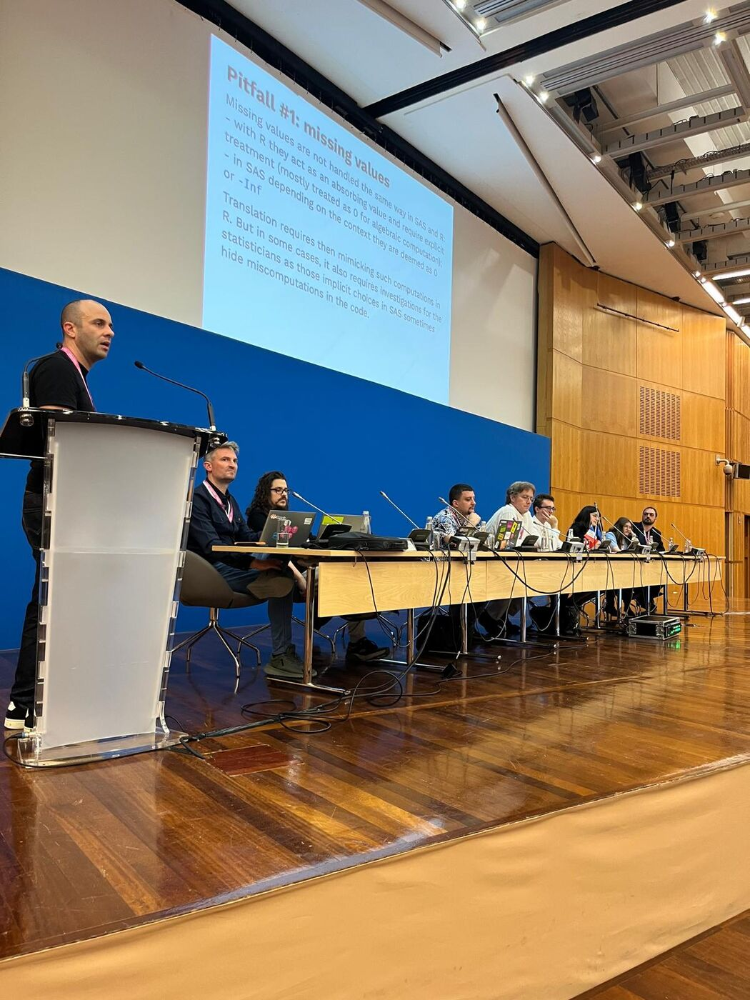{.lightbox group="day-3-2nd-day-of-the-conference-4" description="A5 - Lightning Talks II: R Tools, Visualisation and Applications" fig-alt="Photo 10 of 11 from uRos2026, Day 3 · 2nd day of the Conference: A5 - Lightning Talks II: R Tools, Visualisation and Applications" loading="lazy"}

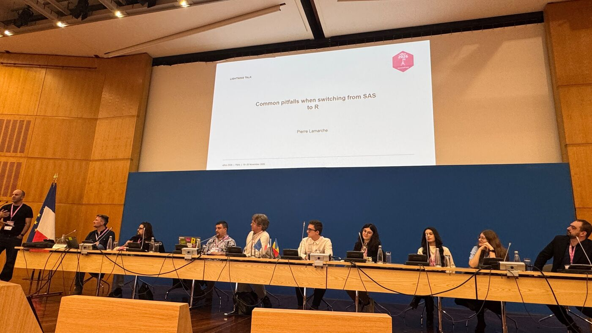{.lightbox group="day-3-2nd-day-of-the-conference-4" description="A5 - Lightning Talks II: R Tools, Visualisation and Applications" fig-alt="Photo 11 of 11 from uRos2026, Day 3 · 2nd day of the Conference: A5 - Lightning Talks II: R Tools, Visualisation and Applications" loading="lazy"}

:::

[C4 - Infrastructure and Tools for Statistical Production]{.photo-caption}

::: {.photo-grid}

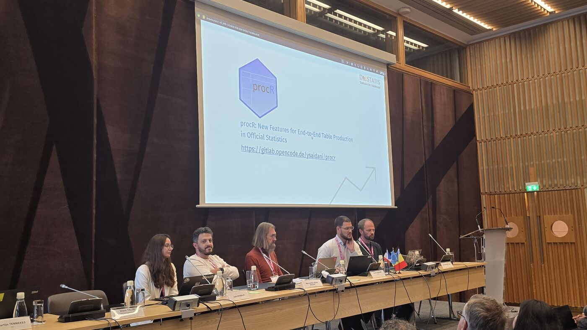{.lightbox group="day-3-2nd-day-of-the-conference-5" description="C4 - Infrastructure and Tools for Statistical Production" fig-alt="Photo 1 of 5 from uRos2026, Day 3 · 2nd day of the Conference: C4 - Infrastructure and Tools for Statistical Production" loading="lazy"}

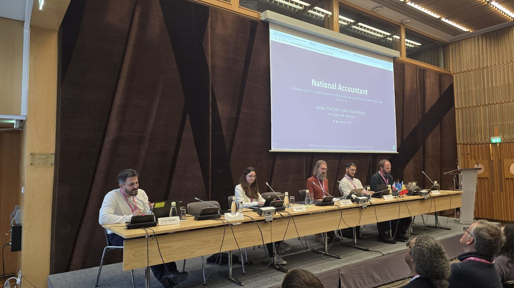{.lightbox group="day-3-2nd-day-of-the-conference-5" description="C4 - Infrastructure and Tools for Statistical Production" fig-alt="Photo 2 of 5 from uRos2026, Day 3 · 2nd day of the Conference: C4 - Infrastructure and Tools for Statistical Production" loading="lazy"}

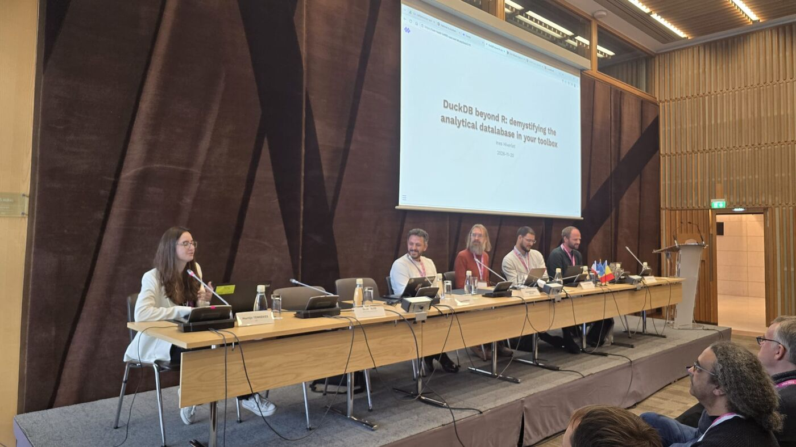{.lightbox group="day-3-2nd-day-of-the-conference-5" description="C4 - Infrastructure and Tools for Statistical Production" fig-alt="Photo 3 of 5 from uRos2026, Day 3 · 2nd day of the Conference: C4 - Infrastructure and Tools for Statistical Production" loading="lazy"}

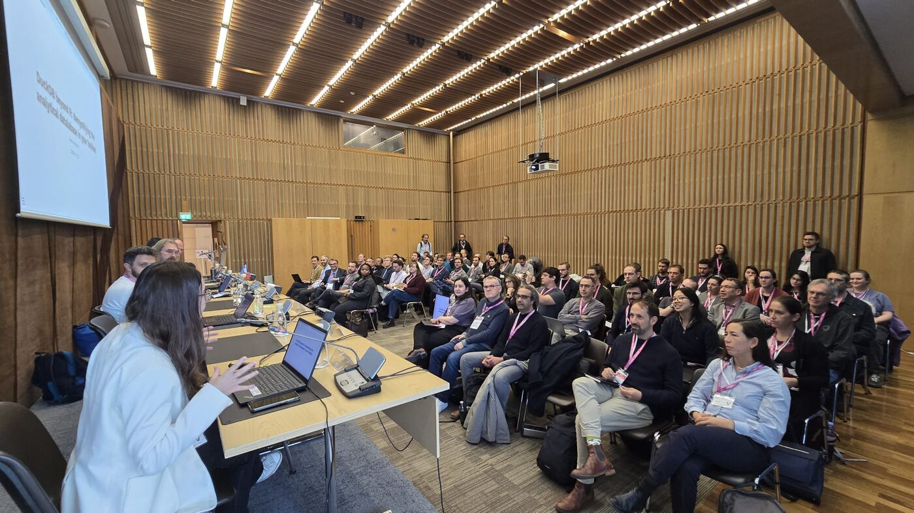{.lightbox group="day-3-2nd-day-of-the-conference-5" description="C4 - Infrastructure and Tools for Statistical Production" fig-alt="Photo 4 of 5 from uRos2026, Day 3 · 2nd day of the Conference: C4 - Infrastructure and Tools for Statistical Production" loading="lazy"}

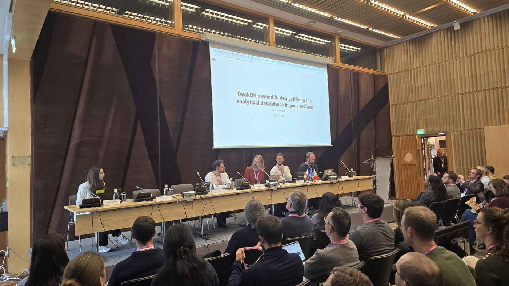{.lightbox group="day-3-2nd-day-of-the-conference-5" description="C4 - Infrastructure and Tools for Statistical Production" fig-alt="Photo 5 of 5 from uRos2026, Day 3 · 2nd day of the Conference: C4 - Infrastructure and Tools for Statistical Production" loading="lazy"}

:::

[B4 - Social and Economic Applications]{.photo-caption}

::: {.photo-grid}

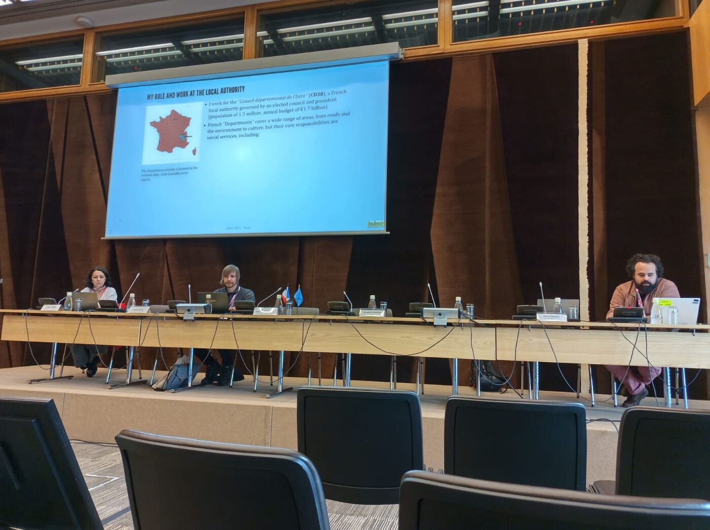{.lightbox group="day-3-2nd-day-of-the-conference-6" description="B4 - Social and Economic Applications" fig-alt="Photo 1 of 1 from uRos2026, Day 3 · 2nd day of the Conference: B4 - Social and Economic Applications" loading="lazy"}

:::

[A4 - Survey Sampling, Weighting and Variance Estimation]{.photo-caption}

::: {.photo-grid}

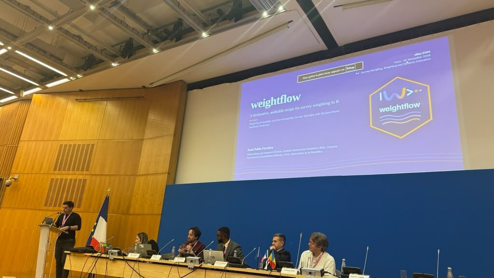{.lightbox group="day-3-2nd-day-of-the-conference-7" description="A4 - Survey Sampling, Weighting and Variance Estimation" fig-alt="Photo 1 of 6 from uRos2026, Day 3 · 2nd day of the Conference: A4 - Survey Sampling, Weighting and Variance Estimation" loading="lazy"}

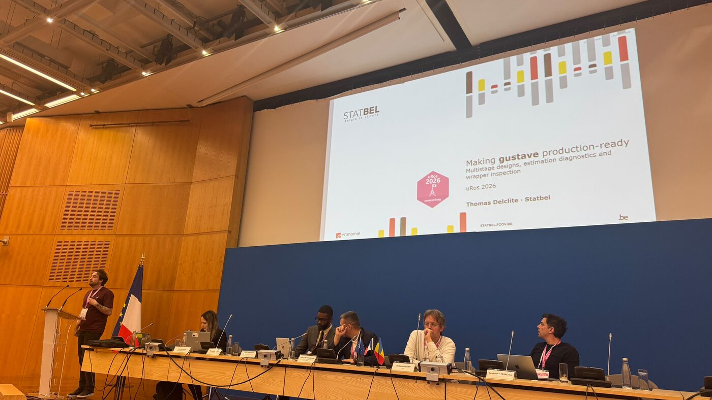{.lightbox group="day-3-2nd-day-of-the-conference-7" description="A4 - Survey Sampling, Weighting and Variance Estimation" fig-alt="Photo 2 of 6 from uRos2026, Day 3 · 2nd day of the Conference: A4 - Survey Sampling, Weighting and Variance Estimation" loading="lazy"}

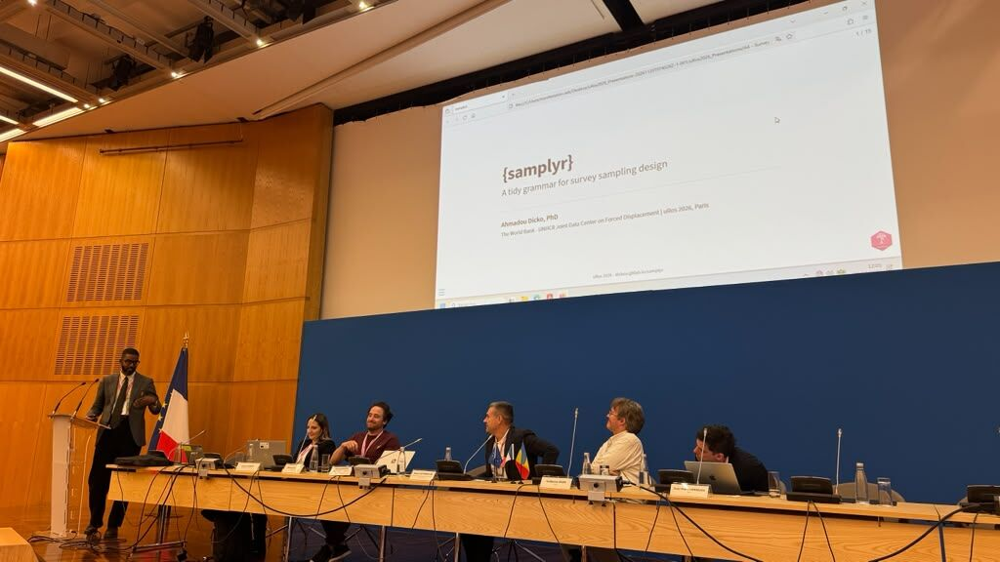{.lightbox group="day-3-2nd-day-of-the-conference-7" description="A4 - Survey Sampling, Weighting and Variance Estimation" fig-alt="Photo 3 of 6 from uRos2026, Day 3 · 2nd day of the Conference: A4 - Survey Sampling, Weighting and Variance Estimation" loading="lazy"}

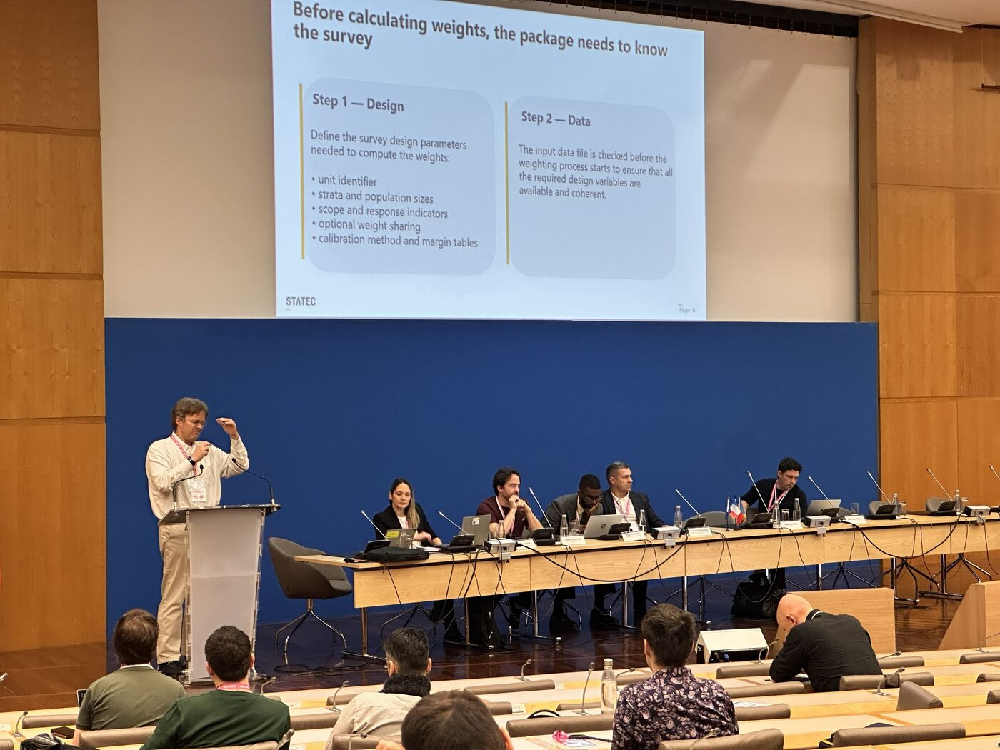{.lightbox group="day-3-2nd-day-of-the-conference-7" description="A4 - Survey Sampling, Weighting and Variance Estimation" fig-alt="Photo 4 of 6 from uRos2026, Day 3 · 2nd day of the Conference: A4 - Survey Sampling, Weighting and Variance Estimation" loading="lazy"}

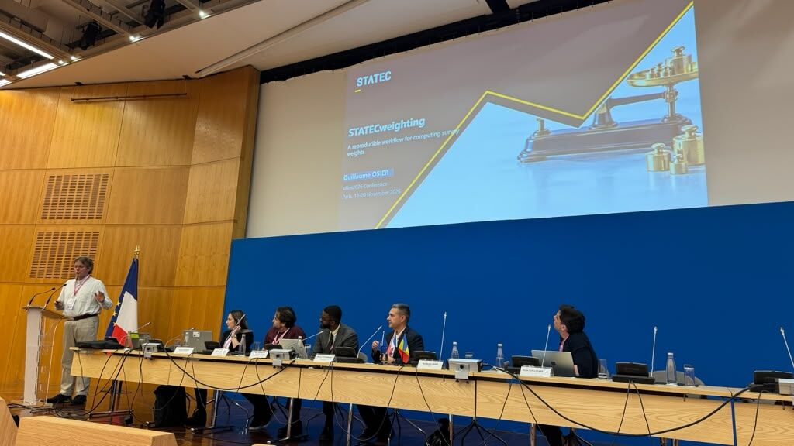{.lightbox group="day-3-2nd-day-of-the-conference-7" description="A4 - Survey Sampling, Weighting and Variance Estimation" fig-alt="Photo 5 of 6 from uRos2026, Day 3 · 2nd day of the Conference: A4 - Survey Sampling, Weighting and Variance Estimation" loading="lazy"}

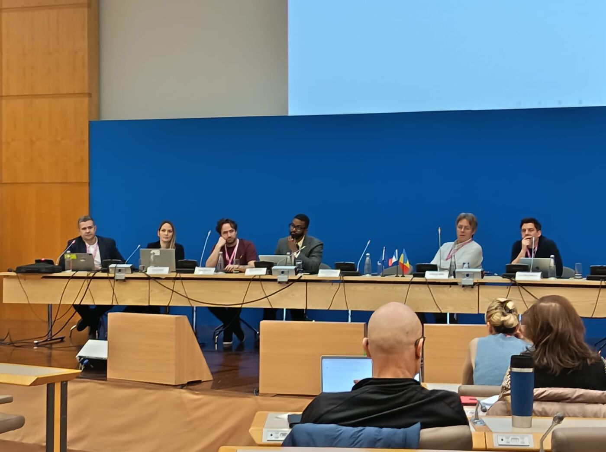{.lightbox group="day-3-2nd-day-of-the-conference-7" description="A4 - Survey Sampling, Weighting and Variance Estimation" fig-alt="Photo 6 of 6 from uRos2026, Day 3 · 2nd day of the Conference: A4 - Survey Sampling, Weighting and Variance Estimation" loading="lazy"}

:::

[EMOS session II]{.photo-caption}

::: {.photo-grid}

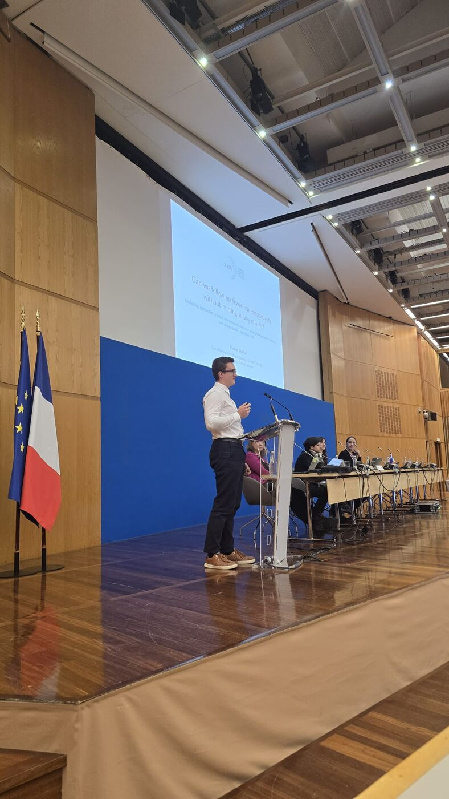{.lightbox group="day-3-2nd-day-of-the-conference-8" description="EMOS session II" fig-alt="Photo 1 of 4 from uRos2026, Day 3 · 2nd day of the Conference: EMOS session II" loading="lazy"}

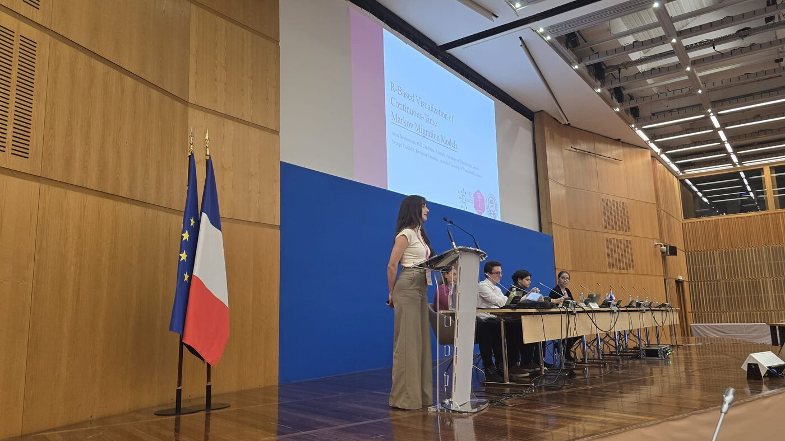{.lightbox group="day-3-2nd-day-of-the-conference-8" description="EMOS session II" fig-alt="Photo 2 of 4 from uRos2026, Day 3 · 2nd day of the Conference: EMOS session II" loading="lazy"}

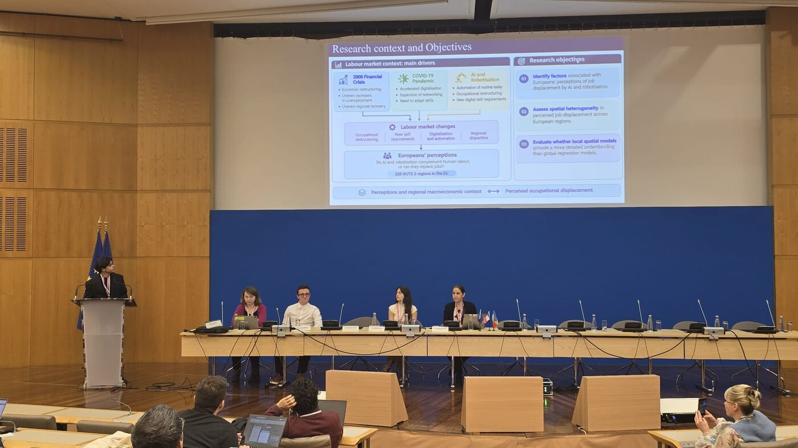{.lightbox group="day-3-2nd-day-of-the-conference-8" description="EMOS session II" fig-alt="Photo 3 of 4 from uRos2026, Day 3 · 2nd day of the Conference: EMOS session II" loading="lazy"}

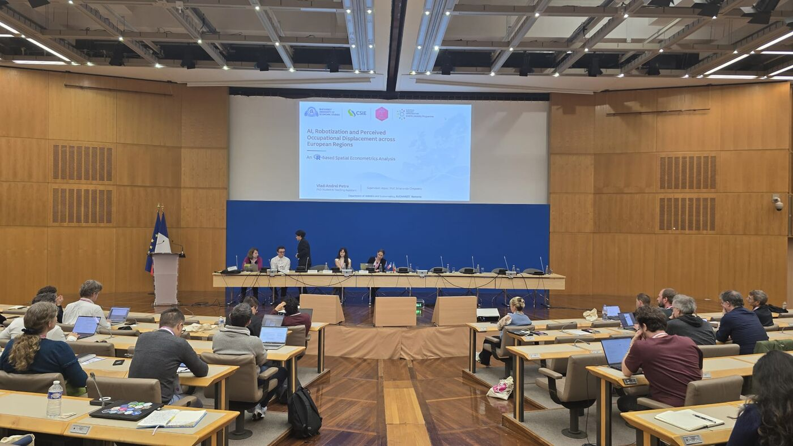{.lightbox group="day-3-2nd-day-of-the-conference-8" description="EMOS session II" fig-alt="Photo 4 of 4 from uRos2026, Day 3 · 2nd day of the Conference: EMOS session II" loading="lazy"}

:::

[Simon Couch, Keynote Speaker, present "Practical AI for Data Science"]{.photo-caption}

::: {.photo-grid}

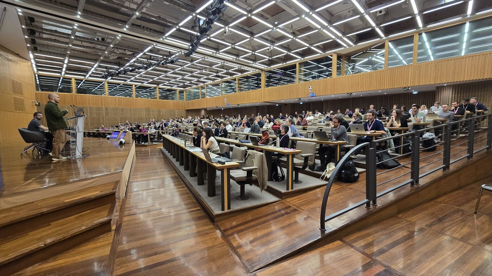{.lightbox group="day-3-2nd-day-of-the-conference-9" description="Simon Couch, Keynote Speaker, present 'Practical AI for Data Science'" fig-alt="Photo 1 of 6 from uRos2026, Day 3 · 2nd day of the Conference: Simon Couch, Keynote Speaker, present 'Practical AI for Data Science'" loading="lazy"}

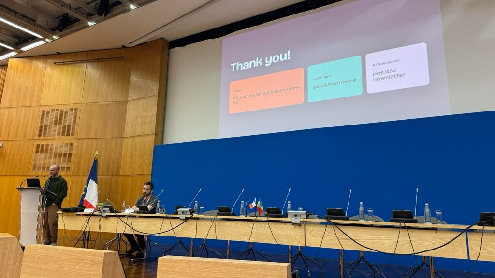{.lightbox group="day-3-2nd-day-of-the-conference-9" description="Simon Couch, Keynote Speaker, present 'Practical AI for Data Science'" fig-alt="Photo 2 of 6 from uRos2026, Day 3 · 2nd day of the Conference: Simon Couch, Keynote Speaker, present 'Practical AI for Data Science'" loading="lazy"}

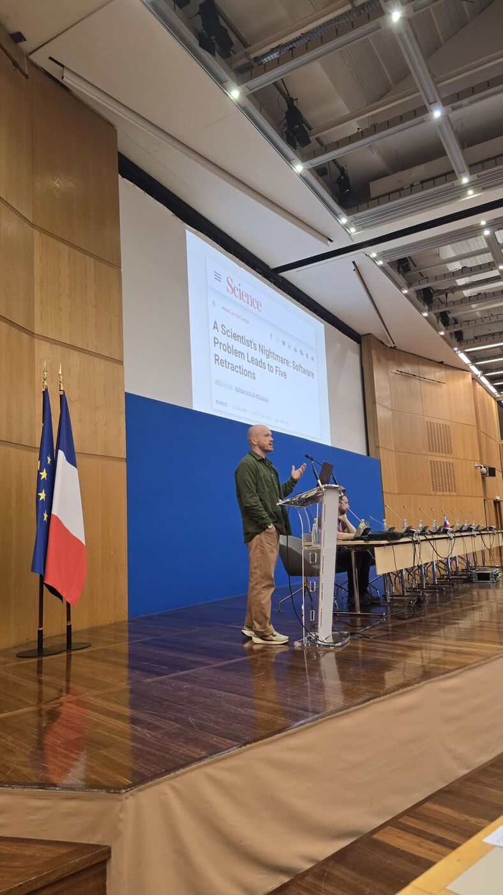{.lightbox group="day-3-2nd-day-of-the-conference-9" description="Simon Couch, Keynote Speaker, present 'Practical AI for Data Science'" fig-alt="Photo 3 of 6 from uRos2026, Day 3 · 2nd day of the Conference: Simon Couch, Keynote Speaker, present 'Practical AI for Data Science'" loading="lazy"}

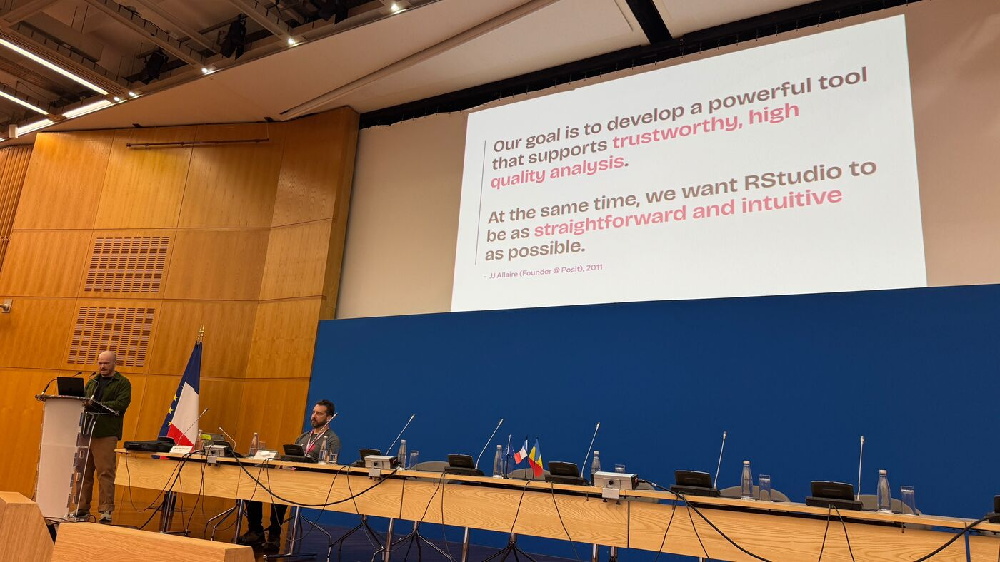{.lightbox group="day-3-2nd-day-of-the-conference-9" description="Simon Couch, Keynote Speaker, present 'Practical AI for Data Science'" fig-alt="Photo 4 of 6 from uRos2026, Day 3 · 2nd day of the Conference: Simon Couch, Keynote Speaker, present 'Practical AI for Data Science'" loading="lazy"}

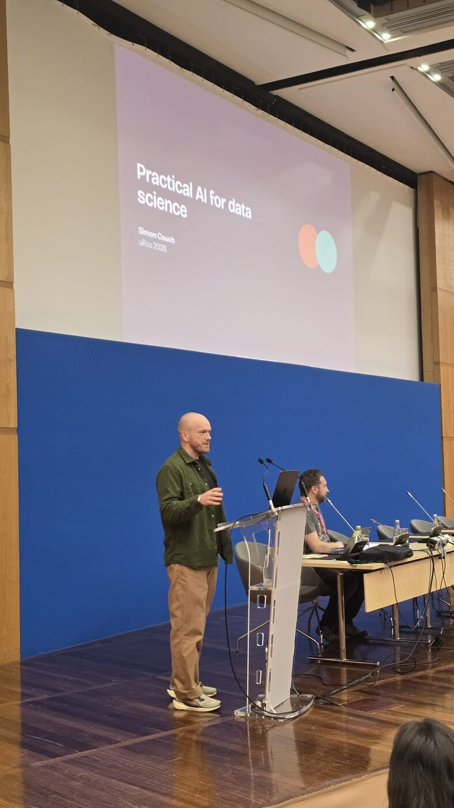{.lightbox group="day-3-2nd-day-of-the-conference-9" description="Simon Couch, Keynote Speaker, present 'Practical AI for Data Science'" fig-alt="Photo 5 of 6 from uRos2026, Day 3 · 2nd day of the Conference: Simon Couch, Keynote Speaker, present 'Practical AI for Data Science'" loading="lazy"}

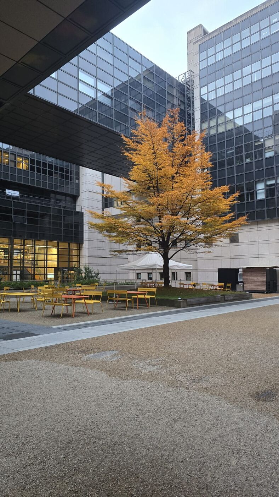{.lightbox group="day-3-2nd-day-of-the-conference-9" description="Simon Couch, Keynote Speaker, present 'Practical AI for Data Science'" fig-alt="Photo 6 of 6 from uRos2026, Day 3 · 2nd day of the Conference: Simon Couch, Keynote Speaker, present 'Practical AI for Data Science'" loading="lazy"}

:::

### Day 2 · 1st day of the Conference

[B2 - Lightning Talks I: Production, Validation and Survey Methods]{.photo-caption}

::: {.photo-grid}

{.lightbox group="day-2-1st-day-of-the-conference-0" description="B2 - Lightning Talks I: Production, Validation and Survey Methods" fig-alt="Photo 1 of 1 from uRos2026, Day 2 · 1st day of the Conference: B2 - Lightning Talks I: Production, Validation and Survey Methods" loading="lazy"}

:::

[A2 - AI, Machine Learning and Intelligent Automation]{.photo-caption}

::: {.photo-grid}

{.lightbox group="day-2-1st-day-of-the-conference-1" description="A2 - AI, Machine Learning and Intelligent Automation" fig-alt="Photo 1 of 1 from uRos2026, Day 2 · 1st day of the Conference: A2 - AI, Machine Learning and Intelligent Automation" loading="lazy"}

:::

[C1 - Automated and Accessible Statistical Outputs]{.photo-caption}

::: {.photo-grid}

{.lightbox group="day-2-1st-day-of-the-conference-2" description="C1 - Automated and Accessible Statistical Outputs" fig-alt="Photo 1 of 1 from uRos2026, Day 2 · 1st day of the Conference: C1 - Automated and Accessible Statistical Outputs" loading="lazy"}

:::

[B1 - Reproducible Statistical Production Pipelines]{.photo-caption}

::: {.photo-grid}

{.lightbox group="day-2-1st-day-of-the-conference-3" description="B1 - Reproducible Statistical Production Pipelines" fig-alt="Photo 1 of 8 from uRos2026, Day 2 · 1st day of the Conference: B1 - Reproducible Statistical Production Pipelines" loading="lazy"}

{.lightbox group="day-2-1st-day-of-the-conference-3" description="B1 - Reproducible Statistical Production Pipelines" fig-alt="Photo 2 of 8 from uRos2026, Day 2 · 1st day of the Conference: B1 - Reproducible Statistical Production Pipelines" loading="lazy"}

{.lightbox group="day-2-1st-day-of-the-conference-3" description="B1 - Reproducible Statistical Production Pipelines" fig-alt="Photo 3 of 8 from uRos2026, Day 2 · 1st day of the Conference: B1 - Reproducible Statistical Production Pipelines" loading="lazy"}

{.lightbox group="day-2-1st-day-of-the-conference-3" description="B1 - Reproducible Statistical Production Pipelines" fig-alt="Photo 4 of 8 from uRos2026, Day 2 · 1st day of the Conference: B1 - Reproducible Statistical Production Pipelines" loading="lazy"}

{.lightbox group="day-2-1st-day-of-the-conference-3" description="B1 - Reproducible Statistical Production Pipelines" fig-alt="Photo 5 of 8 from uRos2026, Day 2 · 1st day of the Conference: B1 - Reproducible Statistical Production Pipelines" loading="lazy"}

{.lightbox group="day-2-1st-day-of-the-conference-3" description="B1 - Reproducible Statistical Production Pipelines" fig-alt="Photo 6 of 8 from uRos2026, Day 2 · 1st day of the Conference: B1 - Reproducible Statistical Production Pipelines" loading="lazy"}

{.lightbox group="day-2-1st-day-of-the-conference-3" description="B1 - Reproducible Statistical Production Pipelines" fig-alt="Photo 7 of 8 from uRos2026, Day 2 · 1st day of the Conference: B1 - Reproducible Statistical Production Pipelines" loading="lazy"}

{.lightbox group="day-2-1st-day-of-the-conference-3" description="B1 - Reproducible Statistical Production Pipelines" fig-alt="Photo 8 of 8 from uRos2026, Day 2 · 1st day of the Conference: B1 - Reproducible Statistical Production Pipelines" loading="lazy"}

:::

[A1 - AI Assistants for Statistical Production]{.photo-caption}

::: {.photo-grid}

{.lightbox group="day-2-1st-day-of-the-conference-4" description="A1 - AI Assistants for Statistical Production" fig-alt="Photo 1 of 2 from uRos2026, Day 2 · 1st day of the Conference: A1 - AI Assistants for Statistical Production" loading="lazy"}

{.lightbox group="day-2-1st-day-of-the-conference-4" description="A1 - AI Assistants for Statistical Production" fig-alt="Photo 2 of 2 from uRos2026, Day 2 · 1st day of the Conference: A1 - AI Assistants for Statistical Production" loading="lazy"}

:::

[EMOS session I]{.photo-caption}

::: {.photo-grid}

{.lightbox group="day-2-1st-day-of-the-conference-5" description="EMOS session I" fig-alt="Photo 1 of 6 from uRos2026, Day 2 · 1st day of the Conference: EMOS session I" loading="lazy"}

{.lightbox group="day-2-1st-day-of-the-conference-5" description="EMOS session I" fig-alt="Photo 2 of 6 from uRos2026, Day 2 · 1st day of the Conference: EMOS session I" loading="lazy"}

{.lightbox group="day-2-1st-day-of-the-conference-5" description="EMOS session I" fig-alt="Photo 3 of 6 from uRos2026, Day 2 · 1st day of the Conference: EMOS session I" loading="lazy"}

{.lightbox group="day-2-1st-day-of-the-conference-5" description="EMOS session I" fig-alt="Photo 4 of 6 from uRos2026, Day 2 · 1st day of the Conference: EMOS session I" loading="lazy"}

{.lightbox group="day-2-1st-day-of-the-conference-5" description="EMOS session I" fig-alt="Photo 5 of 6 from uRos2026, Day 2 · 1st day of the Conference: EMOS session I" loading="lazy"}

{.lightbox group="day-2-1st-day-of-the-conference-5" description="EMOS session I" fig-alt="Photo 6 of 6 from uRos2026, Day 2 · 1st day of the Conference: EMOS session I" loading="lazy"}

:::

[Rebecca Killick, Keynote Speaker, present "R and Open-Source: A love story"]{.photo-caption}

::: {.photo-grid}

{.lightbox group="day-2-1st-day-of-the-conference-6" description="Rebecca Killick, Keynote Speaker, present 'R and Open-Source: A love story'" fig-alt="Photo 1 of 6 from uRos2026, Day 2 · 1st day of the Conference: Rebecca Killick, Keynote Speaker, present 'R and Open-Source: A love story'" loading="lazy"}

{.lightbox group="day-2-1st-day-of-the-conference-6" description="Rebecca Killick, Keynote Speaker, present 'R and Open-Source: A love story'" fig-alt="Photo 2 of 6 from uRos2026, Day 2 · 1st day of the Conference: Rebecca Killick, Keynote Speaker, present 'R and Open-Source: A love story'" loading="lazy"}

{.lightbox group="day-2-1st-day-of-the-conference-6" description="Rebecca Killick, Keynote Speaker, present 'R and Open-Source: A love story'" fig-alt="Photo 3 of 6 from uRos2026, Day 2 · 1st day of the Conference: Rebecca Killick, Keynote Speaker, present 'R and Open-Source: A love story'" loading="lazy"}

{.lightbox group="day-2-1st-day-of-the-conference-6" description="Rebecca Killick, Keynote Speaker, present 'R and Open-Source: A love story'" fig-alt="Photo 4 of 6 from uRos2026, Day 2 · 1st day of the Conference: Rebecca Killick, Keynote Speaker, present 'R and Open-Source: A love story'" loading="lazy"}

{.lightbox group="day-2-1st-day-of-the-conference-6" description="Rebecca Killick, Keynote Speaker, present 'R and Open-Source: A love story'" fig-alt="Photo 5 of 6 from uRos2026, Day 2 · 1st day of the Conference: Rebecca Killick, Keynote Speaker, present 'R and Open-Source: A love story'" loading="lazy"}

{.lightbox group="day-2-1st-day-of-the-conference-6" description="Rebecca Killick, Keynote Speaker, present 'R and Open-Source: A love story'" fig-alt="Photo 6 of 6 from uRos2026, Day 2 · 1st day of the Conference: Rebecca Killick, Keynote Speaker, present 'R and Open-Source: A love story'" loading="lazy"}

:::

[Opening remarks by Corinne Prost, Director of Methodology and International Relations at Insee]{.photo-caption}

::: {.photo-grid}

{.lightbox group="day-2-1st-day-of-the-conference-7" description="Opening remarks by Corinne Prost, Director of Methodology and International Relations at Insee" fig-alt="Photo 1 of 1 from uRos2026, Day 2 · 1st day of the Conference: Opening remarks by Corinne Prost, Director of Methodology and International Relations at Insee" loading="lazy"}

:::

[Opening]{.photo-caption}

::: {.photo-grid}

{.lightbox group="day-2-1st-day-of-the-conference-8" description="Opening" fig-alt="Photo 1 of 3 from uRos2026, Day 2 · 1st day of the Conference: Opening" loading="lazy"}

{.lightbox group="day-2-1st-day-of-the-conference-8" description="Opening" fig-alt="Photo 2 of 3 from uRos2026, Day 2 · 1st day of the Conference: Opening" loading="lazy"}

{.lightbox group="day-2-1st-day-of-the-conference-8" description="Opening" fig-alt="Photo 3 of 3 from uRos2026, Day 2 · 1st day of the Conference: Opening" loading="lazy"}

:::

::: {.photo-grid}

{.lightbox group="day-2-1st-day-of-the-conference-9" description="Day 2 · 1st day of the Conference" fig-alt="Photo 1 of 3 from uRos2026, Day 2 · 1st day of the Conference" loading="lazy"}

{.lightbox group="day-2-1st-day-of-the-conference-9" description="Day 2 · 1st day of the Conference" fig-alt="Photo 2 of 3 from uRos2026, Day 2 · 1st day of the Conference" loading="lazy"}

{.lightbox group="day-2-1st-day-of-the-conference-9" description="Day 2 · 1st day of the Conference" fig-alt="Photo 3 of 3 from uRos2026, Day 2 · 1st day of the Conference" loading="lazy"}

:::

### Day 1 · Tutorials

[Tutorial "Tidy Survey Analysis in R: Working with Weights and Sampling Designs for Official Statistics" delivered by Stephanie Zimmer, Rebecca Powell, Isabella Velásquez]{.photo-caption}

::: {.photo-grid}

{.lightbox group="day-1-tutorials-0" description="Tutorial 'Tidy Survey Analysis in R: Working with Weights and Sampling Designs for Official Statistics' delivered by Stephanie Zimmer, Rebecca Powell, Isabella Velásquez" fig-alt="Photo 1 of 3 from uRos2026, Day 1 · Tutorials: Tutorial 'Tidy Survey Analysis in R: Working with Weights and Sampling Designs for Official Statistics' delivered by Stephanie Zimmer, Rebecca Powell, Isabella Velásquez" loading="lazy"}

{.lightbox group="day-1-tutorials-0" description="Tutorial 'Tidy Survey Analysis in R: Working with Weights and Sampling Designs for Official Statistics' delivered by Stephanie Zimmer, Rebecca Powell, Isabella Velásquez" fig-alt="Photo 2 of 3 from uRos2026, Day 1 · Tutorials: Tutorial 'Tidy Survey Analysis in R: Working with Weights and Sampling Designs for Official Statistics' delivered by Stephanie Zimmer, Rebecca Powell, Isabella Velásquez" loading="lazy"}

{.lightbox group="day-1-tutorials-0" description="Tutorial 'Tidy Survey Analysis in R: Working with Weights and Sampling Designs for Official Statistics' delivered by Stephanie Zimmer, Rebecca Powell, Isabella Velásquez" fig-alt="Photo 3 of 3 from uRos2026, Day 1 · Tutorials: Tutorial 'Tidy Survey Analysis in R: Working with Weights and Sampling Designs for Official Statistics' delivered by Stephanie Zimmer, Rebecca Powell, Isabella Velásquez" loading="lazy"}

:::

[Tutorial "Opening the Black Box: Interpreting Machine Learning Models with SHAP Values in R" delivered by Thelma Panaiotis]{.photo-caption}

::: {.photo-grid}

{.lightbox group="day-1-tutorials-1" description="Tutorial 'Opening the Black Box: Interpreting Machine Learning Models with SHAP Values in R' delivered by Thelma Panaiotis" fig-alt="Photo 1 of 1 from uRos2026, Day 1 · Tutorials: Tutorial 'Opening the Black Box: Interpreting Machine Learning Models with SHAP Values in R' delivered by Thelma Panaiotis" loading="lazy"}

:::

[Tutorial "Working with categorical data and codelists in R" delivered by Jan van Der Laan, Edwin de Jonge]{.photo-caption}

::: {.photo-grid}

{.lightbox group="day-1-tutorials-2" description="Tutorial 'Working with categorical data and codelists in R' delivered by Jan van Der Laan, Edwin de Jonge" fig-alt="Photo 1 of 3 from uRos2026, Day 1 · Tutorials: Tutorial 'Working with categorical data and codelists in R' delivered by Jan van Der Laan, Edwin de Jonge" loading="lazy"}

{.lightbox group="day-1-tutorials-2" description="Tutorial 'Working with categorical data and codelists in R' delivered by Jan van Der Laan, Edwin de Jonge" fig-alt="Photo 2 of 3 from uRos2026, Day 1 · Tutorials: Tutorial 'Working with categorical data and codelists in R' delivered by Jan van Der Laan, Edwin de Jonge" loading="lazy"}

{.lightbox group="day-1-tutorials-2" description="Tutorial 'Working with categorical data and codelists in R' delivered by Jan van Der Laan, Edwin de Jonge" fig-alt="Photo 3 of 3 from uRos2026, Day 1 · Tutorials: Tutorial 'Working with categorical data and codelists in R' delivered by Jan van Der Laan, Edwin de Jonge" loading="lazy"}

:::

[Tutorial "From Data to Models: Hands-On Machine Learning with R" delivered by Adrián Pérez Bote, Sandra Barragán Andrés]{.photo-caption}

::: {.photo-grid}

{.lightbox group="day-1-tutorials-3" description="Tutorial 'From Data to Models: Hands-On Machine Learning with R' delivered by Adrián Pérez Bote, Sandra Barragán Andrés" fig-alt="Photo 1 of 3 from uRos2026, Day 1 · Tutorials: Tutorial 'From Data to Models: Hands-On Machine Learning with R' delivered by Adrián Pérez Bote, Sandra Barragán Andrés" loading="lazy"}

{.lightbox group="day-1-tutorials-3" description="Tutorial 'From Data to Models: Hands-On Machine Learning with R' delivered by Adrián Pérez Bote, Sandra Barragán Andrés" fig-alt="Photo 2 of 3 from uRos2026, Day 1 · Tutorials: Tutorial 'From Data to Models: Hands-On Machine Learning with R' delivered by Adrián Pérez Bote, Sandra Barragán Andrés" loading="lazy"}

{.lightbox group="day-1-tutorials-3" description="Tutorial 'From Data to Models: Hands-On Machine Learning with R' delivered by Adrián Pérez Bote, Sandra Barragán Andrés" fig-alt="Photo 3 of 3 from uRos2026, Day 1 · Tutorials: Tutorial 'From Data to Models: Hands-On Machine Learning with R' delivered by Adrián Pérez Bote, Sandra Barragán Andrés" loading="lazy"}

:::

[Tutorial "R in the Age of LLMs: From AI-Assisted Development to Chat-Based Data Applications - II" delivered by François Michonneau]{.photo-caption}

::: {.photo-grid}

{.lightbox group="day-1-tutorials-4" description="Tutorial 'R in the Age of LLMs: From AI-Assisted Development to Chat-Based Data Applications - II' delivered by François Michonneau" fig-alt="Photo 1 of 2 from uRos2026, Day 1 · Tutorials: Tutorial 'R in the Age of LLMs: From AI-Assisted Development to Chat-Based Data Applications - II' delivered by François Michonneau" loading="lazy"}

{.lightbox group="day-1-tutorials-4" description="Tutorial 'R in the Age of LLMs: From AI-Assisted Development to Chat-Based Data Applications - II' delivered by François Michonneau" fig-alt="Photo 2 of 2 from uRos2026, Day 1 · Tutorials: Tutorial 'R in the Age of LLMs: From AI-Assisted Development to Chat-Based Data Applications - II' delivered by François Michonneau" loading="lazy"}

:::

[Tutorial "Managing statistical disclosure control from microdata to protected linked tables with rtauargus" delivered by Nadège Ferrer-Pradines, Julien Desclodure]{.photo-caption}

::: {.photo-grid}

{.lightbox group="day-1-tutorials-5" description="Tutorial 'Managing statistical disclosure control from microdata to protected linked tables with rtauargus' delivered by Nadège Ferrer-Pradines, Julien Desclodure" fig-alt="Photo 1 of 3 from uRos2026, Day 1 · Tutorials: Tutorial 'Managing statistical disclosure control from microdata to protected linked tables with rtauargus' delivered by Nadège Ferrer-Pradines, Julien Desclodure" loading="lazy"}

{.lightbox group="day-1-tutorials-5" description="Tutorial 'Managing statistical disclosure control from microdata to protected linked tables with rtauargus' delivered by Nadège Ferrer-Pradines, Julien Desclodure" fig-alt="Photo 2 of 3 from uRos2026, Day 1 · Tutorials: Tutorial 'Managing statistical disclosure control from microdata to protected linked tables with rtauargus' delivered by Nadège Ferrer-Pradines, Julien Desclodure" loading="lazy"}

{.lightbox group="day-1-tutorials-5" description="Tutorial 'Managing statistical disclosure control from microdata to protected linked tables with rtauargus' delivered by Nadège Ferrer-Pradines, Julien Desclodure" fig-alt="Photo 3 of 3 from uRos2026, Day 1 · Tutorials: Tutorial 'Managing statistical disclosure control from microdata to protected linked tables with rtauargus' delivered by Nadège Ferrer-Pradines, Julien Desclodure" loading="lazy"}

:::

[Tutorial "Mapping Official Statistics with the tmapverse and cols4all" delivered by Martijn Tennekes]{.photo-caption}

::: {.photo-grid}

{.lightbox group="day-1-tutorials-6" description="Tutorial 'Mapping Official Statistics with the tmapverse and cols4all' delivered by Martijn Tennekes" fig-alt="Photo 1 of 3 from uRos2026, Day 1 · Tutorials: Tutorial 'Mapping Official Statistics with the tmapverse and cols4all' delivered by Martijn Tennekes" loading="lazy"}

{.lightbox group="day-1-tutorials-6" description="Tutorial 'Mapping Official Statistics with the tmapverse and cols4all' delivered by Martijn Tennekes" fig-alt="Photo 2 of 3 from uRos2026, Day 1 · Tutorials: Tutorial 'Mapping Official Statistics with the tmapverse and cols4all' delivered by Martijn Tennekes" loading="lazy"}

{.lightbox group="day-1-tutorials-6" description="Tutorial 'Mapping Official Statistics with the tmapverse and cols4all' delivered by Martijn Tennekes" fig-alt="Photo 3 of 3 from uRos2026, Day 1 · Tutorials: Tutorial 'Mapping Official Statistics with the tmapverse and cols4all' delivered by Martijn Tennekes" loading="lazy"}

:::

[Tutorial "R in the Age of LLMs: From AI-Assisted Development to Chat-Based Data Applications - I" delivered by François Michonneau]{.photo-caption}

::: {.photo-grid}

{.lightbox group="day-1-tutorials-7" description="Tutorial 'R in the Age of LLMs: From AI-Assisted Development to Chat-Based Data Applications - I' delivered by François Michonneau" fig-alt="Photo 1 of 1 from uRos2026, Day 1 · Tutorials: Tutorial 'R in the Age of LLMs: From AI-Assisted Development to Chat-Based Data Applications - I' delivered by François Michonneau" loading="lazy"}

:::

[Tutorial "Spatial Analysis and Cartography with R" delivered by Kim Antunez]{.photo-caption}

::: {.photo-grid}

{.lightbox group="day-1-tutorials-8" description="Tutorial 'Spatial Analysis and Cartography with R' delivered by Kim Antunez" fig-alt="Photo 1 of 4 from uRos2026, Day 1 · Tutorials: Tutorial 'Spatial Analysis and Cartography with R' delivered by Kim Antunez" loading="lazy"}

{.lightbox group="day-1-tutorials-8" description="Tutorial 'Spatial Analysis and Cartography with R' delivered by Kim Antunez" fig-alt="Photo 2 of 4 from uRos2026, Day 1 · Tutorials: Tutorial 'Spatial Analysis and Cartography with R' delivered by Kim Antunez" loading="lazy"}

{.lightbox group="day-1-tutorials-8" description="Tutorial 'Spatial Analysis and Cartography with R' delivered by Kim Antunez" fig-alt="Photo 3 of 4 from uRos2026, Day 1 · Tutorials: Tutorial 'Spatial Analysis and Cartography with R' delivered by Kim Antunez" loading="lazy"}

{.lightbox group="day-1-tutorials-8" description="Tutorial 'Spatial Analysis and Cartography with R' delivered by Kim Antunez" fig-alt="Photo 4 of 4 from uRos2026, Day 1 · Tutorials: Tutorial 'Spatial Analysis and Cartography with R' delivered by Kim Antunez" loading="lazy"}

:::

[Tutorial "Getting Started with Positron: A Next-Generation IDE for Data Science" delivered by François Michonneau, Christophe Dervieux, Mine Çetinkaya-Rundel]{.photo-caption}

::: {.photo-grid}

{.lightbox group="day-1-tutorials-9" description="Tutorial 'Getting Started with Positron: A Next-Generation IDE for Data Science' delivered by François Michonneau, Christophe Dervieux, Mine Çetinkaya-Rundel" fig-alt="Photo 1 of 3 from uRos2026, Day 1 · Tutorials: Tutorial 'Getting Started with Positron: A Next-Generation IDE for Data Science' delivered by François Michonneau, Christophe Dervieux, Mine Çetinkaya-Rundel" loading="lazy"}

{.lightbox group="day-1-tutorials-9" description="Tutorial 'Getting Started with Positron: A Next-Generation IDE for Data Science' delivered by François Michonneau, Christophe Dervieux, Mine Çetinkaya-Rundel" fig-alt="Photo 2 of 3 from uRos2026, Day 1 · Tutorials: Tutorial 'Getting Started with Positron: A Next-Generation IDE for Data Science' delivered by François Michonneau, Christophe Dervieux, Mine Çetinkaya-Rundel" loading="lazy"}

{.lightbox group="day-1-tutorials-9" description="Tutorial 'Getting Started with Positron: A Next-Generation IDE for Data Science' delivered by François Michonneau, Christophe Dervieux, Mine Çetinkaya-Rundel" fig-alt="Photo 3 of 3 from uRos2026, Day 1 · Tutorials: Tutorial 'Getting Started with Positron: A Next-Generation IDE for Data Science' delivered by François Michonneau, Christophe Dervieux, Mine Çetinkaya-Rundel" loading="lazy"}

:::

[And they start coming...]{.photo-caption}

::: {.photo-grid}

{.lightbox group="day-1-tutorials-10" description="And they start coming..." fig-alt="Photo 1 of 1 from uRos2026, Day 1 · Tutorials: And they start coming..." loading="lazy"}

:::

[Waiting for participants...]{.photo-caption}

::: {.photo-grid}

{.lightbox group="day-1-tutorials-11" description="Waiting for participants..." fig-alt="Photo 1 of 6 from uRos2026, Day 1 · Tutorials: Waiting for participants..." loading="lazy"}

{.lightbox group="day-1-tutorials-11" description="Waiting for participants..." fig-alt="Photo 2 of 6 from uRos2026, Day 1 · Tutorials: Waiting for participants..." loading="lazy"}

{.lightbox group="day-1-tutorials-11" description="Waiting for participants..." fig-alt="Photo 3 of 6 from uRos2026, Day 1 · Tutorials: Waiting for participants..." loading="lazy"}

{.lightbox group="day-1-tutorials-11" description="Waiting for participants..." fig-alt="Photo 4 of 6 from uRos2026, Day 1 · Tutorials: Waiting for participants..." loading="lazy"}

{.lightbox group="day-1-tutorials-11" description="Waiting for participants..." fig-alt="Photo 5 of 6 from uRos2026, Day 1 · Tutorials: Waiting for participants..." loading="lazy"}

{.lightbox group="day-1-tutorials-11" description="Waiting for participants..." fig-alt="Photo 6 of 6 from uRos2026, Day 1 · Tutorials: Waiting for participants..." loading="lazy"}

:::

### Day 0

[Organizing committee @ work]{.photo-caption}

::: {.photo-grid}

{.lightbox group="day-0-0" description="Organizing committee @ work" fig-alt="Photo 1 of 2 from uRos2026, Day 0: Organizing committee @ work" loading="lazy"}

{.lightbox group="day-0-0" description="Organizing committee @ work" fig-alt="Photo 2 of 2 from uRos2026, Day 0: Organizing committee @ work" loading="lazy"}

:::

:::
