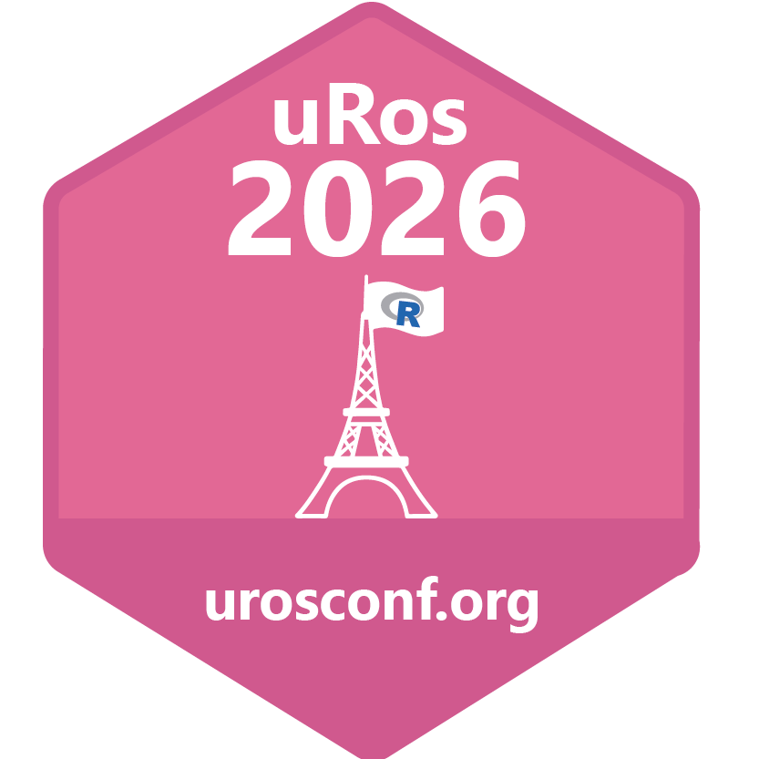

::: {.hero}
::: {}
# The Use of R in Official Statistics

The annual international conference for official statisticians, methodologists and data scientists who use R, since 2013.

**Latest edition:** uRos2026 · Paris, France · 18–20 November 2026, hosted by INSEE.

[uRos2026 conference](conferences/2026/index.qmd){.btn .btn-light .btn-lg .me-2 .mb-2}
[Live & photos](conferences/2026/live.qmd){.btn .btn-outline-light .btn-lg .me-2 .mb-2}
[All editions](conferences/index.qmd){.btn .btn-outline-light .btn-lg .mb-2}
:::

::: {.hero-logo}
[{fig-alt="uRos2026 hex sticker: the Eiffel Tower flying an R flag, with urosconf.org at the bottom."}](conferences/2026/index.qmd)
:::
:::

## Why R in official statistics?

Over the last two decades R has become the *lingua franca* for statisticians, methodologists and data scientists worldwide. It has an active worldwide community of users, wide support from the industry, and a vast amount of functionality for data preparation, methodology, visualisation and application building. As a free (libre) Open Source product, R is an ideal environment for sharing, collaboration and industrialising official statistics. [More about uRos →](about.qmd)

## Recent editions

::: {#recent}
:::

[See every edition since 2013 →](conferences/index.qmd)

## Stay in touch

Follow uRos on [LinkedIn](https://www.linkedin.com/company/the-use-of-r-in-official-statistics-uros/posts) for announcements and calls for abstracts. Interested in hosting a future edition? See [Conferences](conferences/index.qmd).
